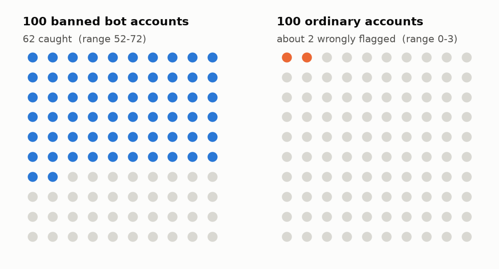
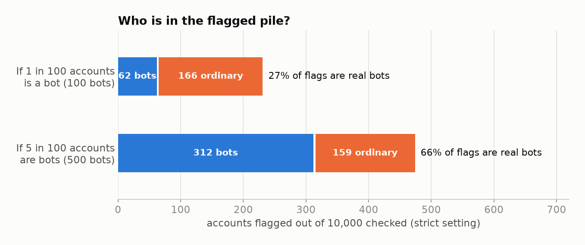
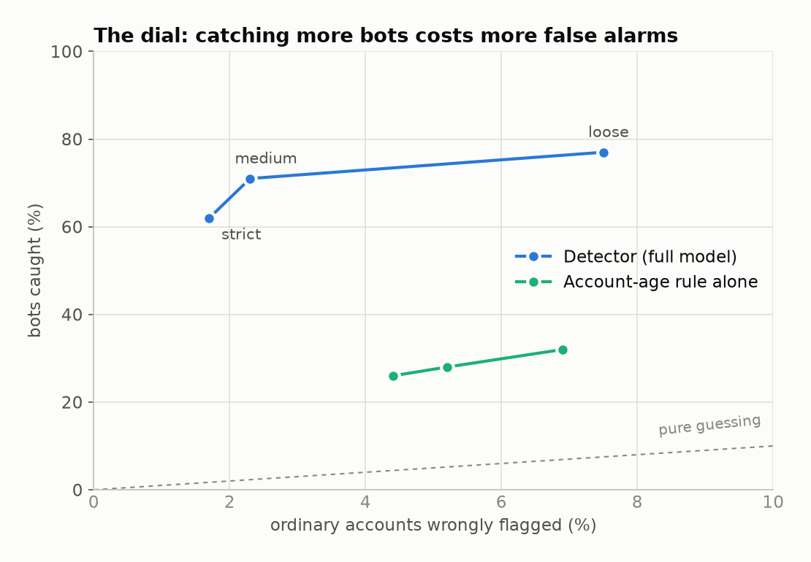
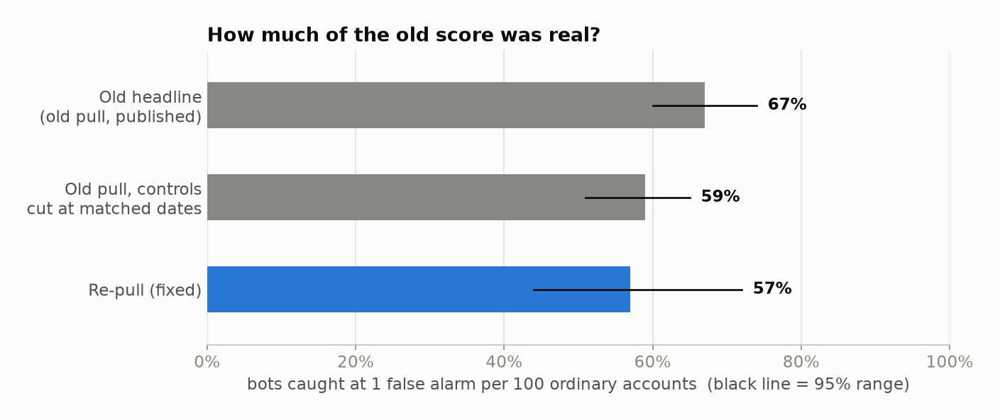
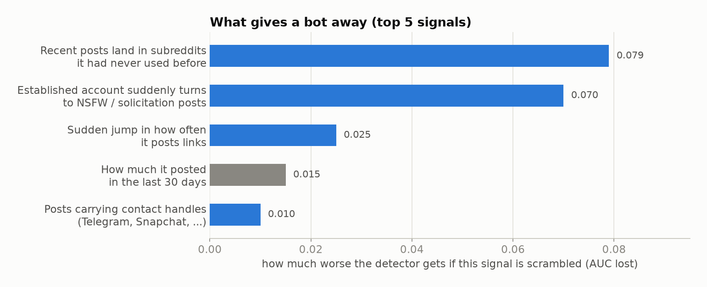
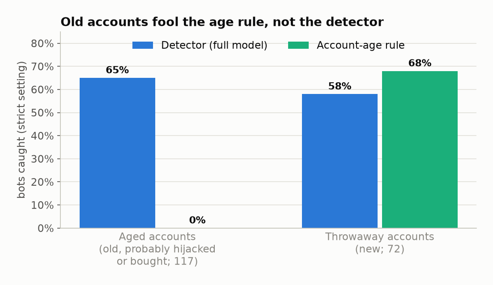
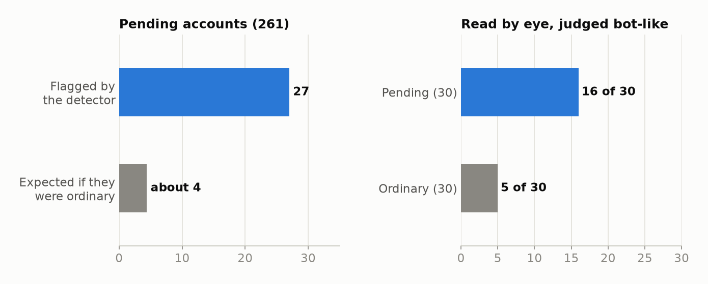

# The re-pull results, explained

This explains what the re-pull numbers in [repull-results.md](repull-results.md) mean, in plain terms: what each
chart shows, what it tells you, and how far you can take it. Nothing here is new analysis; it is the same numbers
(Nov 6 run, reproduced byte for byte on Nov 9), redrawn to answer one question per chart.

## Background in one paragraph

The detector looks at a Reddit account's posting history and gives it a bot score. To test it we use accounts Bot
Bouncer **banned** as bots (the "bots" below), **ordinary** accounts picked at random from the same subreddits (the
"controls"), and **pending** accounts Bot Bouncer had been told about but not yet decided on (as of Oct 28). The old
test said the detector caught 67% of bots. We suspected that was inflated by how histories were downloaded: the
download keeps an account's newest 1,000 items, and banned accounts often kept posting after Bot Bouncer listed them, so their
history looked different from the ordinary accounts' for reasons that had nothing to do with being a bot. The
re-pull downloaded every account's history up to the same kind of cut-off date, so the comparison is fair.

## Words used below

- **Caught (recall):** of the real bots, the share the detector flags.
- **False alarm:** an ordinary account the detector flags. The **false-alarm rate** is the share of ordinary accounts flagged.
- **Setting (threshold):** how high a score has to be before the detector flags an account. Stricter means fewer false alarms but fewer bots caught.
- **Range (95% CI):** with a few hundred test accounts, every number is an estimate. The range is where the true value plausibly lies; a wide range means "don't lean hard on the exact number".
- **AUC:** one number for how well scores separate bots from ordinary accounts overall. 0.5 is guessing, 1.0 is perfect. It's useful for comparing versions, less useful for deciding anything.

## 1. What the detector does, in one picture

**What it shows.** At its strictest setting, out of 100 banned bots the detector flags 62. Out of 100 ordinary accounts it wrongly flags about 2.

**What it means.** It catches a solid majority of bots while bothering very few ordinary accounts. It still misses about 4 in 10 bots, so not being flagged doesn't mean an account is clean.

**How far you can take it.** With 189 bots in the test, the honest range on "62 caught" is about 52 to 72. Treat it as "roughly 6 in 10", not as exactly 62%. The setting was meant to give 1 false alarm per 100; on these accounts it gave about 1.7, so expect closer to 2.

## 2. If the detector flags an account, how likely is it really a bot?

**What it shows.** Imagine running the detector over 10,000 accounts. How many of the flagged ones are actually bots depends on how common bots are to begin with. If 1 in 100 accounts is a bot, the flagged pile holds about 62 bots and 166 ordinary accounts. If 5 in 100 are bots, it holds about 312 bots and 159 ordinary accounts.

**What it means.** When bots are rare, most flags are false alarms, even though the false-alarm rate looks tiny. That's because 2% of a very large number of ordinary accounts outnumbers the bots. Where bots are common (a targeted or brigaded thread), a flag is much more likely to be right.

**How far you can take it.** This is why a flag is a lead to check, never proof that an account is a bot. In a typical subreddit, expect roughly 1 in 4 flags to be a real bot (range about 1 in 5 to 3 in 5). Nobody knows the true share of bots in a given subreddit, so these two rows are scenarios, not measurements.

## 3. The trade-off: catching more costs more false alarms

**What it shows.** Each dot is one setting. Loosening the setting moves up (more bots caught) and to the right (more ordinary accounts flagged). The dashed line is what random guessing would do.

**What it means.** Going from strict to medium buys about 9 more bots per 100 for well under 1 extra false alarm per 100, a good trade. Going on to loose buys only 6 more bots per 100 for 5 extra false alarms, a bad one. The account-age rule on its own sits much lower: it catches about a quarter of bots, whatever the setting.

**How far you can take it.** If flags get checked by a person, the medium setting is probably the sweet spot. If flags trigger anything automatic, stay strict. Account age alone is not a usable detector.

## 4. How much of the old 67% was real?

**What it shows.** All three bars are measured the same way: bots caught when 1 in 100 ordinary accounts is flagged. The old published number was 67%. The re-pull gives 57%. The middle bar uses the old downloads but cuts the ordinary accounts' histories at dates matched to the bans, and it already gets 59%.

**What it means.** About 10 points of the old headline came from the download artifact, not from spotting bots. The detector is still good, just not as good as first reported.

**How far you can take it.** The middle bar suggests most of the inflation came from when each account's history was cut off, more than from the 1,000-item cap itself. That's my reading, not something a prediction tested. The re-pull's range (44-72%) is wide and still overlaps 67%, so the test can't rule out that some of the old number was real.

## 5. What gives a bot away

**What it shows.** These are the five signals the detector leans on most. Each bar shows how much worse the detector gets if that one signal is scrambled.

**What it means.** The strongest clues are about change: an account that suddenly starts posting in subreddits it never used, an established account that turns to NSFW or solicitation posts, or a jump in links. That fits the pattern found by reading accounts by eye: an ordinary history that gets taken over and turned to spam. The grey bar, how much the account posted recently, is the one leftover that measures volume rather than behavior.

**How far you can take it.** Bots that are built from scratch and never change their behavior would be harder for this detector to catch. The volume signal is small enough that the fix removed most of what it was doing before.

## 6. Old accounts fool the age rule, not the detector

**What it shows.** Bots split into two kinds: aged accounts, which are old and probably hijacked or bought, and throwaways, which are newly made. The detector catches both at about the same rate. The age rule catches none of the aged ones, because they're old by definition.

**What it means.** The detector isn't just measuring account age. Behavior signals do the work for aged accounts, which are most of the bots here (117 of 189).

**How far you can take it.** The prediction that the fix would mostly hurt aged-bot detection didn't hold clearly: aged fell 4 points and throwaway 3, within the noise. For throwaway accounts the age rule is about as good as the detector, so a brand-new account is a cheap, rough signal on its own.

## 7. The pending accounts

**What it shows.** Of 261 accounts still waiting on a Bot Bouncer decision, the detector flags 27. If they were like ordinary accounts you'd expect about 4. In the separate by-eye read, 16 of 30 pending accounts looked bot-like, against 5 of 30 ordinary ones.

**What it means.** Pending accounts really do lean bot-like. Both methods agree, and neither result is plausibly chance (p = 4e-7 and p = 0.006).

**How far you can take it.** Since the detector catches about 6 in 10 bots, 27 flags suggests very roughly 9-21% of the pending accounts behave like the banned bots. The by-eye read says about half look bot-like. The gap could mean pending bots differ from the banned ones, or that the by-eye judgment is looser, or it's small-sample noise (30 accounts). This is about the group; it says nothing about any one pending account.

## Bottom line

- The detector works, but the real figure is about **6 in 10 bots caught at about 2 false alarms per 100**, not the
  old 67% at 1 per 100. About 10 points of the old headline was a download artifact.
- **Flags are leads.** When bots are rare, most flags are ordinary accounts, so every flag needs a person to check it.
- It works by spotting **accounts that suddenly change behavior**, which is the takeover-and-spam pattern most of
  these bots follow. It doesn't depend on account age.
- **Pending accounts lean bot-like** as a group, by both the detector and the by-eye read.
- Every number has a wide range (often 10 points either way) because the test has under 200 bots. A bigger test
  set would narrow that more than any change to the detector would.

Caveat: the comparison rows that used the old downloads with each account's last item as the cut-off date ran
only once. Repeat runs failed because of the laptop's RAM fault, so they aren't reproduced and aren't used in
this explainer. Everything here is from re-pull runs that reproduced byte for byte, plus the old-download
matched-date run, which also reproduced.
